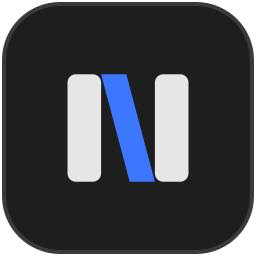

<p align="center">
  
</p>

<h1 align="center">Nemux</h1>

<p align="center">
  Terminais em abas com uma memória compartilhada para o Claude Code.
</p>

---

O Nemux é um app desktop para Windows (e, em teste, Linux), feito em Rust com [Slint](https://slint.dev),
para rodar vários terminais lado a lado e dar às sessões do
[Claude Code](https://claude.com/claude-code) uma **memória persistente em comum**.

O que o Claude aprende numa aba (uma decisão, uma preferência sua, um detalhe
do projeto) fica salvo num banco SQLite local e pode ser encontrado por qualquer
outra sessão, hoje ou amanhã.

```
Aba 1: claude ─┐
Aba 2: claude ─┼──► nemux-mcp ──► nemux.db (SQLite + busca FTS5)
Aba 3: claude ─┘                     ▲
                                     └── painel de memória do app
```

## Recursos

- **Terminais reais em abas**: cada aba roda um shell no ConPTY do Windows
  (PowerShell por padrão), com cores de 16, 256 e 24 bits, negrito, itálico,
  sublinhado, caracteres largos e 10 mil linhas de histórico.
- **Painéis divididos**: divida qualquer aba ao lado ou abaixo, quantas vezes
  quiser, e veja vários terminais (ou várias sessões do Claude) ao mesmo tempo.
  Arraste a divisória entre dois painéis para redimensioná-los; um duplo clique
  nela volta a dividir ao meio.
- **Abas com nome e na ordem que você quiser**: dê duplo clique numa aba para
  dar um nome a ela ("API", "front"…); o nome fica no lugar do título que o
  programa define e volta ao reabrir o Nemux (um nome vazio volta ao título do
  programa). Arraste as abas para reordená-las, ou use `Ctrl+Shift+PageUp` /
  `Ctrl+Shift+PageDown`.
- **Seleção e cópia de texto**: arraste para selecionar, dê duplo clique para
  pegar uma palavra ou um caminho de arquivo inteiro.
- **Busca no histórico** (`Ctrl+Shift+F`): procura um texto na tela e nas 10 mil
  linhas de histórico do painel ativo, sem diferenciar maiúsculas, destaca as
  ocorrências e mostra "3 de 17". `Enter` vai para a de cima, `Shift+Enter` para a
  de baixo, e `Esc` fecha.
- **Arrastar arquivos para o terminal**: solte arquivos do Explorer sobre um
  painel e os caminhos são colados nele (entre aspas quando têm espaços ou
  caracteres especiais), prontos para um comando ou para o prompt do Claude.
- **Shift+Enter** quebra a linha no prompt do Claude Code sem enviar.
- **Retomar sessões do Claude**: liste as conversas salvas do Claude Code (com
  título, pasta e quando foram usadas) e continue qualquer uma numa aba nova,
  inclusive as que foram abertas em outro terminal.
- **Memória compartilhada via MCP**: um servidor MCP que o Claude Code usa para
  salvar, buscar e apagar memórias.
- **Painel de memória**: veja, busque, filtre por projeto e apague o que o Claude
  salvou. A lista atualiza sozinha quando alguma sessão grava algo novo.
- **Configurações** (engrenagem ⚙ no canto da barra de abas): **Temas** troca as
  cores na hora (Nemux, One Half Dark, Dracula, Solarized Dark, Gruvbox Dark,
  Tokyo Night e Rosé Pine); **Fonte** aumenta e diminui o texto (também com
  `Ctrl+=`, `Ctrl+-` e `Ctrl+0`); **Restaurar abas ao abrir** liga e desliga a
  restauração; **Uso do Claude na barra** liga o uso do plano na barra de abas
  (veja abaixo); **Abrir config.toml** abre o arquivo no editor (e o cria, se ainda
  não existir); **Atalhos de teclado** lista os atalhos. Tudo fica salvo no
  `config.toml` para a próxima vez.
- **Abas restauradas**: ao fechar e abrir o Nemux, as abas voltam como estavam:
  as divisões e seus tamanhos, a aba e o painel com o foco, a pasta de cada painel
  e as **sessões do Claude**, retomadas com `claude --resume` no painel onde
  estavam (isso precisa da memória ligada; veja abaixo).

- **Uso do Claude Code**: os limites do plano (5 horas e semanal) ficam na barra
  de abas, perto da engrenagem, amarelos a partir de 80% e vermelhos a partir de
  95%; passe o mouse para ver quando cada um zera. Cada painel com o Claude mostra
  no canto quanto do contexto a sessão já ocupou.

- **Avisos**: uma aba escondida com saída nova ganha um ponto cinza. Quando um
  programa pede atenção (o sino, ou uma notificação OSC 9, 99 ou 777) sem você
  estar olhando para ele, a aba ganha um ponto amarelo, o painel uma borda
  amarela e, com o Nemux atrás de outra janela, o botão na barra de tarefas pisca.

### Avisos do Claude Code

O Claude Code só avisa o terminal quando termina ou precisa de você se souber
como: no modo padrão (`auto`) ele reconhece só alguns terminais, e o Nemux não é
um deles. Diga a ele para usar o sino, em `~/.claude/settings.json` (vale para
todas as sessões):

```json
{
  "preferredNotifChannel": "terminal_bell"
}
```

Ou pelo `/config` dentro do Claude. `iterm2` e `iterm2_with_bell` também funcionam:
o Nemux entende o OSC 9 que eles mandam.

### Como as sessões do Claude voltam

Cada painel recebe a variável `NEMUX_PANE`. Quando um Claude abre num painel, o
`nemux-mcp` dele recebe essa variável e o id da sessão (`CLAUDE_CODE_SESSION_ID`)
e anota no banco "a sessão X roda no painel Y"; a anotação some quando o Claude
fecha. Ao fechar o Nemux (e a cada 30 segundos), o app grava as abas em
`%APPDATA%\nemux\session.json` com a sessão de cada painel.

- Sem o servidor MCP registrado, os painéis voltam como shells, sem o Claude.
- Depois de um `/clear`, o Claude começa outra sessão, mas o servidor MCP continua
  com o id antigo: o painel volta com a conversa de antes do `/clear`.
- A pasta de um shell comum só acompanha os `cd` se o prompt avisar o terminal
  (OSC 7 ou OSC 9;9, como no Windows Terminal). Sem isso, o painel volta na pasta
  em que foi aberto. Para o PowerShell, ponha no seu `$PROFILE`:

  ```powershell
  function prompt {
      $loc = $executionContext.SessionState.Path.CurrentLocation
      $osc = if ($loc.Provider.Name -eq "FileSystem") { "$([char]27)]9;9;`"$($loc.ProviderPath)`"$([char]27)\" }
      "$osc" + "PS $loc$('>' * ($nestedPromptLevel + 1)) "
  }
  ```

## Requisitos

- Windows 10 (1809) ou mais recente. No Linux, veja [Linux](#linux) abaixo.
- [Rust](https://rustup.rs) 1.88 ou mais recente, com a toolchain MSVC.
- Para o ícone no `.exe`: o compilador de recursos `rc.exe`, que vem com o
  Windows SDK (instalado junto com as Build Tools do Visual Studio). Sem ele o
  app compila normalmente, só sem ícone no Explorer.
- Para a memória: o [Claude Code](https://claude.com/claude-code).

### Linux

O Nemux já roda no Linux (testado no Linux Mint): os terminais abrem e os testes
da lógica passam. Ainda não foram conferidos lá o arrastar de arquivos, o aviso
piscando na barra de tarefas e a roda do mouse dentro do Claude Code: relatos de
problemas são bem-vindos. As diferenças em relação ao Windows:

- O shell de cada painel é o seu `$SHELL` (ou `/bin/sh`), com `TERM=xterm-256color`.
- A pasta de cada painel é lida do `/proc` na hora de gravar as abas: não precisa
  do snippet de prompt (OSC 7) para o painel voltar na pasta certa.
- "Retomar sessão" abre `claude --resume` e, quando ele termina, o seu shell.
- "Abrir config.toml" usa o `xdg-open`. A configuração fica em
  `~/.config/nemux/config.toml` e o banco em `~/.local/share/nemux/nemux.db`.
- Os testes de interface rodam `cmd.exe` e só existem no Windows; no Linux,
  `cargo test` roda os testes da lógica.

Para compilar (Debian/Ubuntu; em outras distribuições, os pacotes equivalentes):

```bash
sudo apt install build-essential pkg-config libfontconfig1-dev libxkbcommon-dev
cargo build --release -p nemux-app -p nemux-mcp
```

## Começando

```bash
git clone <url-do-repositório> nemux
cd nemux
cargo run --release -p nemux-app
```

A primeira compilação leva alguns minutos por causa do Slint.

### Ligando a memória ao Claude Code

Compile o servidor MCP e registre-o no Claude Code (vale para todos os seus
projetos):

```bash
cargo build --release -p nemux-mcp
claude mcp add --scope user nemux -- C:\caminho\para\nemux\target\release\nemux-mcp.exe
```

Abra uma sessão nova do Claude e confira com `/mcp`. A partir daí o Claude tem
as ferramentas:

| Ferramenta | O que faz |
|---|---|
| `memory_save` | Salva um fato associado a um projeto |
| `memory_search` | Busca por palavras (acentos são ignorados), com filtro opcional de projeto |
| `memory_recent` | Lista as memórias mais recentes de um projeto |
| `memory_delete` | Apaga uma memória errada ou desatualizada |

Para remover: `claude mcp remove nemux -s user`.

> **Dica:** o Windows trava o `nemux-mcp.exe` enquanto alguma sessão do Claude o
> usa. Feche essas sessões antes de recompilar o servidor.

### Uso do Claude na barra

Os números vêm da barra de status do Claude Code: a cada atualização, ela roda
`nemux-mcp statusline`, que grava o uso no banco do Nemux e devolve ao Claude a
linha dele (modelo e contexto). Para ligar, compile o `nemux-mcp` e marque **Uso do
Claude na barra** na engrenagem: o Nemux põe o `statusLine` no
`~/.claude/settings.json` (sem mexer no resto) apontando para o `nemux-mcp` que
está junto do executável (ou, rodando de `target/debug`, o de `target/release`).
Se você já tem uma barra de status sua, ele não a troca: tire-a antes. Desmarcar
tira a do Nemux. À mão, é o mesmo que:

```json
"statusLine": { "type": "command", "command": "\"C:/caminho/para/nemux-mcp.exe\" statusline" }
```

Os limites só aparecem para assinantes do Claude (Pro/Max), e só depois da
primeira resposta de alguma sessão; sem sessões abertas, ficam os últimos números
até a hora de zerar. Sessões abertas antes de ligar só passam a contar quando o
Claude Code reler a configuração.

## Atalhos

| Atalho | Ação |
|---|---|
| `Ctrl+Shift+T` | Nova aba |
| `Ctrl+Tab` / `Ctrl+Shift+Tab` | Próxima / aba anterior |
| `Ctrl+Shift+PageUp` / `Ctrl+Shift+PageDown` | Levar a aba para a esquerda / direita (também arrastando) |
| Duplo clique na aba | Renomear a aba (`Enter` grava, `Esc` desiste; vazio volta ao título do programa) |
| `Alt+Shift+=` | Dividir o painel ao lado (também pelo botão na barra de abas) |
| `Alt+Shift+-` | Dividir o painel abaixo |
| `Alt+←` `→` `↑` `↓` | Ir para o painel vizinho (com um painel só, vão para o programa) |
| `Ctrl+Shift+W` | Fechar o painel (o último painel fecha a aba) |
| `Shift+Enter` | Nova linha no prompt do Claude Code, sem enviar |
| `Ctrl+Shift+C` | Copiar a seleção |
| `Ctrl+C` | Copiar, se houver seleção; senão interrompe o programa |
| `Ctrl+V` / `Ctrl+Shift+V` | Colar |
| Botão direito | Copiar a seleção, ou colar se não houver seleção |
| `Shift+PageUp` / `Shift+PageDown` | Rolar o histórico (também com a roda do mouse ou a barra de rolagem de cada painel) |
| `Ctrl+Shift+F` | Buscar no histórico do painel (`Enter` / `Shift+Enter`: ocorrência acima / abaixo; `Esc` fecha) |
| `Ctrl+=` / `Ctrl+-` / `Ctrl+0` | Aumentar / diminuir / voltar ao padrão o tamanho da fonte |
| `Ctrl+Shift+M` | Abrir / fechar o painel de memória |
| `Ctrl+Shift+R` | Retomar uma sessão do Claude Code (também pelo botão "Sessões") |

### Trazendo uma sessão do Claude de outro terminal

Um programa já rodando em outra janela não pode ser movido para o Nemux (o
Windows não deixa trocar o console de um processo). Mas a conversa do Claude Code
fica salva em disco: abra **Sessões**, escolha a conversa e ela continua numa aba
nova, na pasta certa, com `claude --resume`. Sessões marcadas como **em uso**
foram gravadas nos últimos 2 minutos: feche a janela antiga para não haver duas
cópias da mesma conversa.

## Configuração

Shell, fonte e cores ficam em `%APPDATA%\nemux\config.toml`. O arquivo não
existe até você criá-lo (ou mudar algo pelo menu da engrenagem, que o cria), e
tudo nele é opcional: o que faltar fica com o padrão. Ele é lido ao abrir o app;
depois de editar à mão, feche e abra o Nemux de novo.

```toml
# Linha de comando de cada aba e painel novo.
shell = "pwsh.exe -NoLogo"

# Um dos temas prontos; o menu "Temas" grava esta linha. As cores de [colors]
# e [app] abaixo ficam por cima das do tema: use-as só para ajustar uma ou outra.
theme = "Nemux"

# Reabrir as abas (e as sessões do Claude) da última vez.
restore = true

[font]
family = "Cascadia Mono"   # ou uma Nerd Font, para os ícones do oh-my-posh/Starship
size = 13                  # entre 6 e 72

# Cores do terminal, em "#rrggbb" (ou "#rrggbbaa" para transparência).
[colors]
foreground = "#cccccc"
background = "#1e1e1e"     # também é o fundo dos painéis e da aba ativa
selection = "#3b78ff66"
# As 16 cores ANSI, nesta ordem: preto, vermelho, verde, amarelo, azul,
# magenta, ciano, branco e as 8 versões claras.
palette = [
  "#0c0c0c", "#c50f1f", "#13a10e", "#c19c00", "#0037da", "#881798", "#3a96dd", "#cccccc",
  "#767676", "#e74856", "#16c60c", "#f9f1a5", "#3b78ff", "#b4009e", "#61d6d6", "#f2f2f2",
]

# Cores da interface em volta dos terminais.
[app]
tab_bar = "#2b2b2b"        # barra de abas e painéis laterais
tab_hover = "#383838"      # aba e botões sob o mouse
accent = "#3b78ff"         # aba ativa, painel com foco, divisória arrastada
muted = "#8a8a8a"          # textos secundários e abas inativas
divider = "#3a3a3a"        # espaço entre painéis
```

Os valores acima são os padrões (as cores são as do tema Nemux), exceto `shell` e
`font.family` (o padrão é `powershell.exe -NoLogo` e Consolas 14; no Linux, o seu
`$SHELL` e a fonte monoespaçada do sistema, a de `fc-match monospace`). As cores de
cada tema estão em [`app/src/themes.toml`](app/src/themes.toml). Se o arquivo tiver um erro (uma cor mal
escrita, uma chave desconhecida), o Nemux abre com o padrão e mostra o erro numa
faixa abaixo das abas.

| Variável | Padrão | Para quê |
|---|---|---|
| `NEMUX_SHELL` | `shell` do `config.toml` | Shell de cada aba; tem prioridade sobre a configuração |
| `NEMUX_CONFIG` | `%APPDATA%\nemux\config.toml` | Caminho da configuração |
| `NEMUX_DB` | `%APPDATA%\nemux\nemux.db` | Caminho do banco de memória (app e servidor MCP) |

O servidor MCP também aceita o caminho do banco como argumento:
`nemux-mcp.exe C:\outro\lugar\nemux.db`.

## Estrutura

```
nemux/
├── app/          nemux-app: interface Slint, terminais, seleção e painel de memória
│   ├── src/
│   └── ui/       arquivos .slint e o ícone (ui/icons)
├── memory/       nemux-memory: banco SQLite com busca FTS5
└── mcp-server/   nemux-mcp: servidor MCP (stdio) usado pelo Claude Code e o
                  comando da barra de status (uso do plano)
```

Detalhes de arquitetura e cuidados de desenvolvimento estão no
[CLAUDE.md](CLAUDE.md).

## Desenvolvimento

```bash
cargo test --workspace                  # todos os testes
cargo test-model                        # só a lógica
cargo test-ui                           # só a interface (sem abrir janela)
cargo capturas                          # gera capturas PNG da interface em target/ui-capturas
cargo clippy --workspace --all-targets
cargo fmt --all
```

Os testes de interface rodam no backend de testes do Slint, sem janela. Os
testes de seleção abrem um `cmd.exe` de verdade no ConPTY, e os do painel de
memória usam sempre um banco temporário.

## Limitações conhecidas

- Feito no Windows; no Linux roda, mas parte dos recursos ainda não foi conferida
  (veja [Linux](#linux)). macOS não foi tentado.
- Arrastar a seleção além da borda não rola o histórico, e não há triplo clique.
- `Shift+Enter` envia `ESC CR` (o mesmo que `Alt+Enter`): é o que o Claude Code
  entende como nova linha, e o ConPTY do Windows 10 descarta as codificações
  modernas da tecla. Programas que esperam um Shift+Enter "de verdade" não o recebem.
- A busca não acha um texto quebrado entre duas linhas da tela. Programas em tela
  alternativa (`vim`, `less`, o Claude Code com `"tui": "fullscreen"`) não deixam
  histórico no Nemux: neles a busca só vê o que está na tela.
- O painel de memória ainda não cria nem edita memórias, só lista, busca e apaga.

## Licença

MIT.

O Nemux inclui em `vendor/conpty/` o `conpty.dll` e o `OpenConsole.exe` da
Microsoft (projeto [microsoft/terminal](https://github.com/microsoft/terminal),
licença MIT), a mesma versão do ConPTY usada pelo Windows Terminal. Eles ficam
embutidos no `nemux-app.exe` e são extraídos para `%LOCALAPPDATA%\nemux\conpty`
na primeira execução, então o `.exe` pode ser copiado sozinho para qualquer pasta.
Com essa versão, a roda do mouse funciona dentro do Claude Code e de outros
programas de tela cheia.
